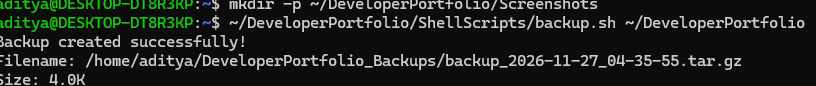
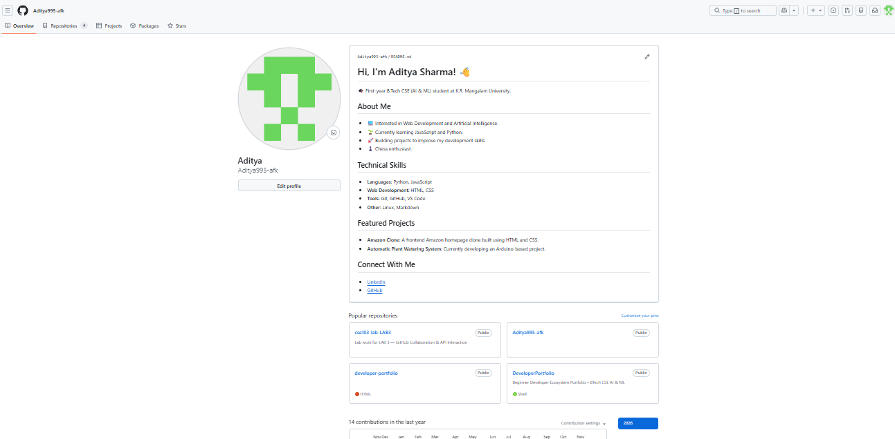
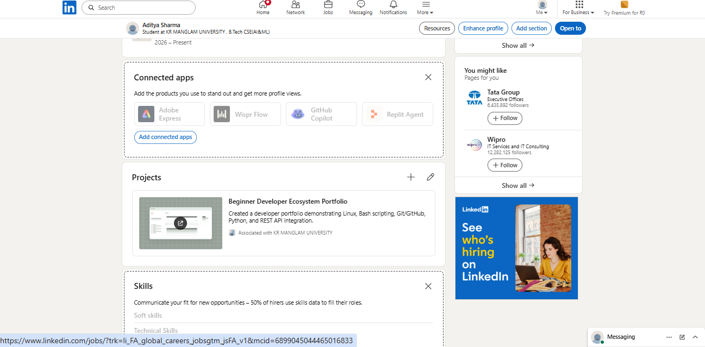

# Beginner Developer Ecosystem Portfolio

**Name:** Aditya Sharma  
**Roll Number:** 2601730014  
**Course:** B.Tech CSE (AI & ML)  
**University:** K.R. Mangalam University

## About This Project

This repository showcases my learning journey as a beginner developer. It contains Linux system documentation, Bash automation scripts, API integration, and my professional developer portfolio.

## Project Sections

### Q1 – Linux Fundamentals
- Linux system profile
- System specifications
- Linux command outputs
- Number system conversions

### Q2 – Shell Scripting
- System information automation
- Automated folder backup
- Backup logs and screenshots

### Q3 – API Integration
- GitHub REST API
- JSON data handling
- Python API interaction

### Q4 – Developer Portfolio
- Professional resume
- Learning roadmap
- GitHub and LinkedIn profiles
- Personal portfolio website

## Technologies Used

- Linux
- Bash
- Git and GitHub
- Python
- HTML and CSS
- JSON
- REST APIs

## Author

**Aditya Sharma**

- GitHub: https://github.com/Aditya995-afk
- LinkedIn: https://linkedin.com/in/aditya-sharma-89ab18430/

## Screenshots

### Backup Demonstration

### GitHub Profile

### LinkedIn Profile

